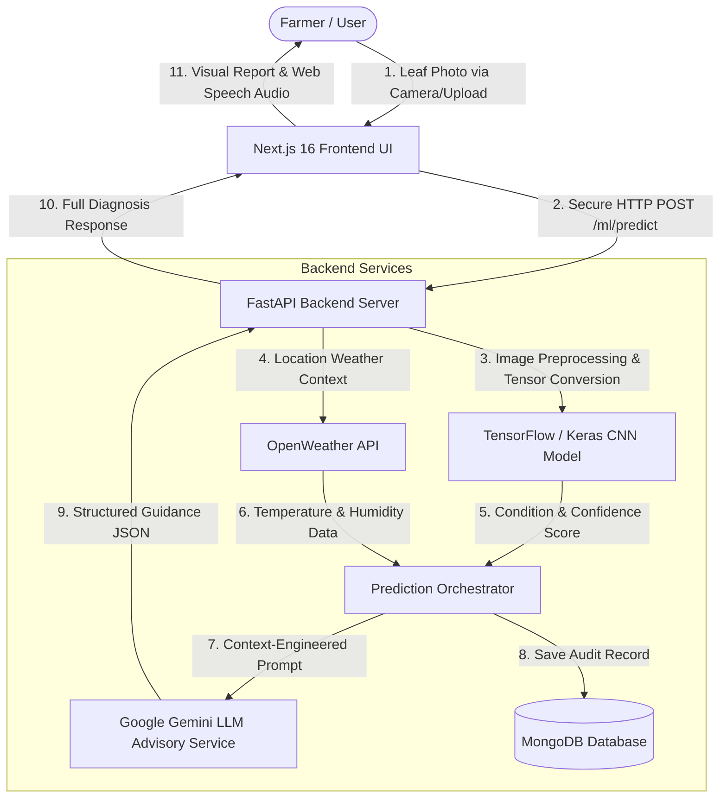

# 🌱 PlantHealth AI (Version 2)

> **Empowering Farmers with Accessible, Deep Learning & LLM-Powered Plant Disease Diagnosis and Field-Ready Advisory**

[](https://fastapi.tiangolo.com/)
[](https://nextjs.org/)
[](https://tensorflow.org/)
[](https://mongodb.com/)
[](LICENSE)

---

## 1. Project Title & Tagline

**PlantHealth AI — Version 2**  
*A practical, AI-driven agricultural assistant engineered to detect crop diseases from leaf imagery and deliver immediate, actionable agronomic advice directly to farmers.*

---

## 2. Problem Statement

Plant diseases cause an estimated 20% to 40% loss of global agricultural crop yield annually. For smallholder farmers—especially across India and developing agricultural economies—several barriers prevent timely intervention:

- **Delayed Diagnosis:** Agricultural extension officers cannot visit every remote field promptly, allowing localized leaf infections to spread across entire fields.
- **Overuse & Misuse of Agro-Chemicals:** Without accurate identification, farmers often apply broad-spectrum chemical fungicides or pesticides indiscriminately, leading to soil toxicity, pest resistance, financial waste, and health hazards.
- **Technical & Literacy Barriers:** Complex agricultural portals use dense botanical terminology and complicated desktop workflows that are inaccessible on mobile devices.
- **Lack of Integrated Context:** Conventional diagnostic tools overlook ambient microclimate factors (such as high relative humidity or imminent rainfall) that accelerate disease spread or nullify chemical sprays.

---

## 3. Solution Overview

**PlantHealth AI V2** bridges this gap by providing an end-to-end, mobile-first agricultural advisory system:

1. **Instant Visual Crop Health Scanner:** A farmer captures or uploads a photo of an affected leaf directly from a smartphone or desktop browser.
2. **Deep Learning Classification:** A specialized Convolutional Neural Network (CNN) analyzes leaf pathology, identifying the specific crop and condition (e.g., Tomato Early Blight, Potato Late Blight, Bell Pepper Bacterial Spot, or Healthy Crop).
3. **Live Microclimate Awareness:** Real-time weather data (temperature, humidity, rainfall, and sky conditions) is gathered for environmental context.
4. **Structured Agronomic Guidance (LLM):** An integrated Large Language Model acts as an agronomy extension specialist, translating raw model predictions into practical immediate actions, safe organic remedies, prevention strategies, and extension advisories without inventing chemical dosages.
5. **In-Browser Audio Advisory:** A Web Speech API reader speaks the diagnosis and management guidance aloud in clear English for farmers who prefer listening over reading.

---

## 4. Key Features (V2)

- 📸 **Streamlined Crop Health Scanner:** One-tap camera capture and image upload with instant client-side preview, validation, and drag-and-drop support.
- 🔬 **High-Accuracy CNN Classifier:** Multi-class leaf pathology recognition trained on agricultural datasets with automated non-leaf / low-confidence rejection.
- 🌦️ **Live Weather & Field Spray Advisory:** Microclimate integration alerting farmers to rain risks, humidity-driven fungal spikes, and spray windows.
- 🧠 **Structured 8-Section Agronomic Advisory:**
  - Disease Overview & Spread Mechanism
  - Observable Visual Symptoms
  - Possible Causes & Biological Triggers
  - Severity Rating (Low, Medium, High) with Damage Impact Explanation
  - Immediate Same-Day Actions
  - Practical Treatment Recommendations (Organic + Approved Controls)
  - Long-Term Preventive Farming Practices
  - Farmer Advisory & Krishi Vigyan Kendra (KVK) Guidance
- 🔊 **Voice Advisory Playback:** Built-in speech synthesis enabling audio playback of diagnosis, severity, and treatments.
- 📜 **Historical Diagnostic Records:** Persistent history tracking past leaf scans with timestamps, confidence scores, and crop health status.
- 🛡️ **Secure Authentication:** JWT-based farmer authentication with HttpOnly cookies and protected API routes.

---

## 5. Architecture Overview

PlantHealth AI follows a decoupled, service-oriented architecture:



---

## 6. Tech Stack

### Frontend
- **Framework:** Next.js 16 (React 19, App Router)
- **Styling:** Tailwind CSS with Lucide React icons
- **Audio:** Browser-native Web Speech API (`SpeechSynthesis`)
- **HTTP Client:** Fetch API with custom error handling and cookie credentials

### Backend
- **Framework:** FastAPI (Python 3.10+)
- **ASGI Server:** Uvicorn with asynchronous lifespan management
- **Data Validation & Schemas:** Pydantic V2
- **Authentication & Security:** Python-JOSE (JWT), Passlib (Bcrypt), HttpOnly Cookies

### Machine Learning & AI
- **Framework:** TensorFlow / Keras (CNN image classification)
- **Image Processing:** Pillow (PIL), NumPy
- **Advisory LLM:** Google Gemini API (`gemini-2.5-flash` / OpenAI-compatible endpoint)

### External APIs & Storage
- **Weather API:** OpenWeather REST API
- **Database:** MongoDB Atlas / Local MongoDB via Motor (AsyncIO driver)

---

## 7. Project Structure

```text
PlantHealth_AI/
├── backend/
│   ├── app/
│   │   ├── core/
│   │   │   ├── config.py             # App settings & environment loader
│   │   │   ├── database.py           # Async Motor MongoDB connection pool
│   │   │   └── security.py           # Password hashing & JWT creation/verification
│   │   ├── models/
│   │   │   ├── prediction_model.py   # Database document schemas
│   │   │   └── user_model.py         # Farmer user database entity
│   │   ├── routes/
│   │   │   ├── auth_route.py         # /auth (signup, login, me, logout)
│   │   │   ├── ml_route.py           # /ml/predict & /ml/history endpoints
│   │   │   ├── user_route.py         # User management
│   │   │   └── weather_route.py      # /weather live status
│   │   ├── schemas/
│   │   │   ├── auth_schema.py        # Pydantic auth request/response schemas
│   │   │   ├── prediction_schema.py  # Structured prediction & guidance schemas
│   │   │   └── user_schema.py        # User public models
│   │   ├── services/
│   │   │   ├── auth_service.py       # Authentication business logic
│   │   │   ├── llm_service.py        # Agricultural advisory prompt engineering & parsing
│   │   │   ├── model_service.py      # Keras CNN loader and inference pipeline
│   │   │   ├── prediction_service.py # Orchestrates ML, Weather, LLM, and DB persistence
│   │   │   └── weather_service.py    # OpenWeather HTTP client
│   │   ├── utils/
│   │   │   └── image_utils.py        # Image format verification and tensor resizing
│   │   └── main.py                   # FastAPI initialization, CORS, and health check
│   ├── .env.example                  # Backend environment variable template
│   └── requirements.txt              # Python package dependencies
│
├── Frontend/
│   ├── app/
│   │   ├── dashboard/
│   │   │   └── page.tsx              # Farmer V2 Dashboard (Scanner, Weather, History, Report)
│   │   ├── signup/
│   │   │   └── page.tsx              # Farmer account registration
│   │   ├── globals.css               # Tailwind CSS theme and styles
│   │   ├── layout.tsx                # App root layout and metadata
│   │   └── page.tsx                  # Login and landing portal
│   ├── components/
│   │   ├── analysis-speech.tsx       # Text-to-speech audio reader component
│   │   ├── camera-capture.tsx        # In-browser camera modal
│   │   ├── auth/
│   │   │   ├── login-form.tsx        # Farmer login form
│   │   │   └── signup-form.tsx       # Registration form
│   │   └── ui/
│   │       └── button.tsx            # Button primitive
│   ├── lib/
│   │   ├── api.ts                    # Typed API client and data contracts
│   │   ├── auth.ts                   # Auth state management
│   │   └── utils.py                  # Tailwind styling helper
│   ├── .env.example                  # Frontend environment variable template
│   ├── package.json                  # Next.js scripts and dependencies
│   └── tsconfig.json                 # TypeScript configuration
└── README.md                         # Project documentation
```

---

## 8. Prerequisites

Ensure you have the following installed locally before setting up:

- **Node.js:** v18.18.0 or newer (LTS recommended)
- **npm:** v9.0.0 or newer
- **Python:** v3.10.x or v3.11.x (64-bit)
- **MongoDB:** Local MongoDB Community Server (v6.0+) or a free [MongoDB Atlas](https://www.mongodb.com/atlas) cluster
- **Git:** Installed and available on system PATH

---

## 9. Environment Variables

### Backend Configuration (`backend/.env`)

| Variable Name | Description | Example / Default |
|---------------|-------------|-------------------|
| `MONGODB_URI` | MongoDB connection URI | `mongodb://localhost:27017` or Atlas URI |
| `DATABASE_NAME` | Name of the database | `planthealth_ai` |
| `JWT_SECRET_KEY` | Secret salt for signing JWT tokens | Strong random 32+ char string |
| `JWT_ALGORITHM` | JWT hashing algorithm | `HS256` |
| `ACCESS_TOKEN_EXPIRE_MINUTES` | Session validity duration | `60` |
| `FRONTEND_URL` | Frontend origin for CORS | `http://localhost:3000` |
| `CORS_ORIGINS` | Allowed cross-origin domains | `http://localhost:3000` |
| `MAX_UPLOAD_SIZE_MB` | Maximum allowed image upload size | `10` |
| `TOKEN_COOKIE_NAME` | Authentication cookie identifier | `planthealth_access_token` |
| `COOKIE_SECURE` | Set `true` in production (HTTPS) | `false` |
| `MODEL_CONFIDENCE_THRESHOLD` | Threshold below which caution is flagged | `0.60` |
| `MODEL_REJECTION_THRESHOLD` | Threshold below which image is rejected | `0.25` |
| `LLM_API_KEY` | API Key for LLM advisory | Obtain from [Google AI Studio](https://aistudio.google.com/) |
| `LLM_API_URL` | Endpoint URL for the LLM service | `https://generativelanguage.googleapis.com/...` |
| `LLM_MODEL` | LLM model identifier | `gemini-2.5-flash` |
| `OPENWEATHER_API_KEY` | OpenWeather API token | Obtain from [OpenWeather](https://openweathermap.org/api) |
| `OPENWEATHER_CITY` | Fallback city for microclimate data | `Bengaluru` |
| `OPENWEATHER_COUNTRY` | Fallback country code | `IN` |

### Frontend Configuration (`Frontend/.env.local`)

| Variable Name | Description | Example / Default |
|---------------|-------------|-------------------|
| `NEXT_PUBLIC_API_BASE_URL` | Base URL of the running FastAPI server | `http://localhost:8000` |

---

## 10. Installation & Setup

### Step 1: Clone Repository
```bash
git clone https://github.com/your-username/PlantHealth_AI.git
cd PlantHealth_AI
```

### Step 2: Backend Setup
```bash
# Navigate to backend directory
cd backend

# Create a virtual environment
python -m venv .venv

# Activate the virtual environment
# Windows (PowerShell):
.venv\Scripts\Activate.ps1
# Linux / macOS:
# source .venv/bin/activate

# Upgrade pip and install dependencies
python -m pip install --upgrade pip
pip install -r requirements.txt

# Configure environment variables
cp .env.example .env
# Edit .env and supply your MONGODB_URI, LLM_API_KEY, and OPENWEATHER_API_KEY
```

### Step 3: Frontend Setup
```bash
# Open a new terminal in the project root
cd Frontend

# Install node dependencies
npm install

# Configure frontend environment variables
cp .env.example .env.local
```

---

## 11. Running the Application

### 1. Start the Backend API Server
From the `backend` directory (with virtual environment activated):
```bash
uvicorn app.main:app --reload --host 127.0.0.1 --port 8000
```
- API Base URL: `http://127.0.0.1:8000`
- Interactive API Docs (Swagger): `http://127.0.0.1:8000/docs`
- Health Check: `http://127.0.0.1:8000/health`

### 2. Start the Frontend Development Server
From the `Frontend` directory:
```bash
npm run dev
```
- Web Application: `http://localhost:3000`
- Open `http://localhost:3000` in your browser to sign up and access the dashboard.

---

## 12. API Documentation

### Key Endpoints

| Method | Endpoint | Description | Auth Required |
|--------|----------|-------------|---------------|
| `GET` | `/health` | Health and connectivity check | No |
| `POST` | `/auth/signup` | Register new farmer account | No |
| `POST` | `/auth/login` | Authenticate farmer and set session cookie | No |
| `GET` | `/auth/me` | Fetch active farmer profile details | Yes |
| `POST` | `/auth/logout` | Clear authentication cookie | Yes |
| `POST` | `/ml/predict` | Upload leaf image for disease diagnosis & advisory | Yes |
| `GET` | `/ml/history` | Retrieve past diagnosis scans | Yes |
| `GET` | `/weather` | Fetch live microclimate weather info | No |

### Sample Prediction Request (`POST /ml/predict`)

**Request:** `multipart/form-data` with `file: <binary image>`

**Sample Response:**
```json
{
  "success": true,
  "prediction": {
    "type": "Disease",
    "class_name": "Tomato___Early_blight",
    "confidence": 0.942,
    "low_confidence": false
  },
  "ai_guidance": {
    "summary": "Tomato Early Blight caused by Alternaria solani was detected on the leaf specimen.",
    "disease_overview": "Early blight affects tomato leaves, stems, and fruits. It is caused by the fungus Alternaria solani and spreads via airborne spores and water splash.",
    "symptoms": [
      "Concentric circular brown or black spots (target-like lesions)",
      "Yellowing halo surrounding older leaf lesions",
      "Premature leaf drop from the bottom up"
    ],
    "possible_causes": [
      "Fungal pathogen Alternaria solani",
      "Prolonged leaf moisture and warm humid weather (24-29°C)"
    ],
    "severity": "Medium",
    "severity_explanation": "If left unaddressed, early defoliation reduces fruit yield and exposes fruit to sunscald.",
    "immediate_actions": [
      "Prune and safely destroy heavily infected lower leaves",
      "Avoid overhead sprinkler watering; switch to drip irrigation",
      "Sanitize pruning tools between plants with a 10% bleach solution"
    ],
    "treatment_recommendations": [
      "Apply organic bio-fungicides such as Trichoderma harzianum or Bacillus subtilis",
      "For severe infections, spray approved copper-based fungicides strictly according to package instructions",
      "Wear protective gloves and mask when applying any agricultural treatment"
    ],
    "prevention": [
      "Practice 3-year crop rotation avoiding Solanaceae family plants",
      "Stake and prune plants to improve airflow and sunlight penetration",
      "Apply clean organic straw mulch to prevent soil splashing onto leaves"
    ],
    "farmer_advisory": "Monitor your field every 3 days. If spots spread across more than 25% of your crop, bring a fresh leaf sample to your local Krishi Vigyan Kendra (KVK).",
    "weather_insight": "Current high humidity (78%) accelerates spore germination. Maintain vigilant inspection."
  },
  "weather_context": {
    "available": true,
    "temperature": 27.5,
    "humidity": 78,
    "condition": "Clouds",
    "location": "Bengaluru"
  },
  "llm_available": true
}
```

---

## 13. Machine Learning Model

- **Architecture:** Deep Convolutional Neural Network (CNN) feature extractor with dense classification heads.
- **Dataset:** Trained on thousands of verified agricultural images from the PlantVillage dataset across crops including Tomato, Potato, and Bell Pepper.
- **Input Requirements:** JPEG or PNG format, RGB color channels, standard resolution automatically normalized to 256×256 pixels.
- **Confidence Scoring & Safety Guardrails:**
  - Standard confidence scores calculated via softmax probability distribution.
  - Rejection threshold ($<25\%$ confidence): Rejects non-plant images or unidentifiable objects.
  - Caution flag ($<60\%$ confidence): Advises the farmer to inspect multiple leaves and seek local confirmation.

---

## 14. LLM-Powered Advisory

PlantHealth AI utilizes Google Gemini to bridge machine learning classification and real-world farm management:

1. **Strict Authoritative Grounding:** The LLM is strictly constrained never to alter the ML classifier's diagnosis. It elaborates on the diagnosed condition with practical knowledge.
2. **Safety & Zero Dosage Invention:** The system prompt prohibits inventing unverified chemical dosages or formulas. It suggests approved cultural methods, organic alternatives, and general chemical categories with instructions to consult certified labels.
3. **Healthy Crop Guidance:** When a plant is diagnosed as healthy, the LLM provides growth promotion, organic nutrient management, and monitoring advice rather than disease treatments.
4. **Environmental Contextualization:** Weather data is incorporated as an environmental catalyst (e.g., explaining how warmth and high moisture speed up fungal growth) without incorrectly blaming weather as the primary pathogen.

---

## 15. Audio Advisory Feature

Farmers often access the application under bright sunlight or while working in the field where reading dense text is inconvenient.

- **Technology:** Employs the browser-native `window.speechSynthesis` API without requiring third-party audio streaming dependencies.
- **Chunked Playback:** Text is cleaned of markdown formatting, punctuation is normalized, and guidance is split into natural sentences.
- **Playback Controls:** Farmers have clear Play, Pause, Resume, and Stop controls directly inside the diagnosis report card.

---

## 16. Farmer-Centric UI/UX Design

The V2 dashboard was redesigned specifically for rural and smallholder farmers:

- **Earthy, Natural Palette:** Warm emerald greens, soft off-white surfaces (`#fbfdf9`), and amber warnings provide high visual clarity in outdoor sunlight.
- **Clear Information Hierarchy:** Prominent Crop Health Scanner at the top, followed by current weather context and diagnosis history.
- **Jargon-Free Terminology:** Plain-language status indicators ("Healthy Crop", "Disease Detected") with confidence explained in simple words.
- **Responsive Mobile-First Layout:** Touch-friendly buttons (minimum 48px height), large typography, and streamlined camera capture.

---

## 17. Testing & Verification

### Frontend Verification
```bash
cd Frontend

# 1. Static Type Checking
npx tsc --noEmit --project tsconfig.json

# 2. Production Webpack Build
npx next build --webpack
```

### Backend Verification
```bash
cd backend

# 1. Python Syntax & Compilation
python -m py_compile app/main.py app/services/llm_service.py app/services/prediction_service.py app/schemas/prediction_schema.py

# 2. Health Endpoint Check (with server running)
curl http://127.0.0.1:8000/health
```

---

## 18. Deployment Guide

### Backend Deployment (e.g., Render / Railway / Docker)
1. Set the root build command to: `pip install -r requirements.txt`
2. Set the start command to: `uvicorn app.main:app --host 0.0.0.0 --port $PORT`
3. Configure all backend environment variables in your cloud dashboard.
4. Ensure `COOKIE_SECURE=true` and update `CORS_ORIGINS` to match your production frontend URL.

### Frontend Deployment (e.g., Vercel)
1. Import the `Frontend` directory into Vercel.
2. Set the Framework Preset to **Next.js**.
3. Set the Environment Variable: `NEXT_PUBLIC_API_BASE_URL=https://your-backend-api.onrender.com`
4. Deploy.

---

## 19. Security Considerations

- **Secret Key Protection:** All API tokens (Gemini, OpenWeather, MongoDB, JWT secret) reside in server-side `.env` files and are never exposed to client bundles.
- **Session Protection:** Authentication tokens are stored in HttpOnly, SameSite cookies to protect against Cross-Site Scripting (XSS).
- **Upload Sanitization:** Uploaded files are verified for MIME types (`image/jpeg`, `image/png`), inspected with Pillow before tensor conversion, and rejected if exceeding 10 MB.
- **Database Fault Tolerance:** MongoDB connection exceptions are handled gracefully without terminating the web service.

---

## 20. Known Limitations

- **Supported Crop Scope:** Current CNN weights focus on Solanaceae crops (Tomatoes, Potatoes, Bell Peppers). Expanding to pulses and cereals is in development.
- **Connectivity Requirement:** Cloud LLM guidance and weather synchronization require an active internet connection.
- **Single-Leaf Focus:** The model is optimized for close-up leaf pathology photos rather than full-canopy or root images.

---

## 21. Future Roadmap

- 📱 Progressive Web App (PWA) with offline scanning capabilities.
- 🌾 Support for additional Indian staple crops (Rice, Wheat, Cotton, Sugarcane).
- 🐛 Dedicated pest and insect infestation classification modules.
- 📍 Geo-tagged regional disease outbreak heatmaps for local farming clusters.
- 🤝 Direct integration with local Krishi Vigyan Kendra (KVK) extension helplines.

---

## 22. Contributing

Contributions are welcome! Please follow these guidelines:

1. Fork the repository and create your feature branch: `git checkout -b feature/crop-enhancement`
2. Run TypeScript checks and Python compilation before committing.
3. Ensure no API keys or `.env` files are tracked in git.
4. Open a Pull Request with a detailed summary of your changes.

---

## 23. License

Distributed under the **MIT License**. See `LICENSE` for more information.

---

## 24. Acknowledgments

- **PlantVillage Dataset:** For providing open-source agricultural image benchmarks.
- **Google DeepMind & Gemini API:** For powering the agronomic advisory reasoning engine.
- **OpenWeather:** For real-time microclimate and meteorological APIs.
- **Agricultural Extension Community:** For guidance on farmer-friendly terminology and disease management practices.
